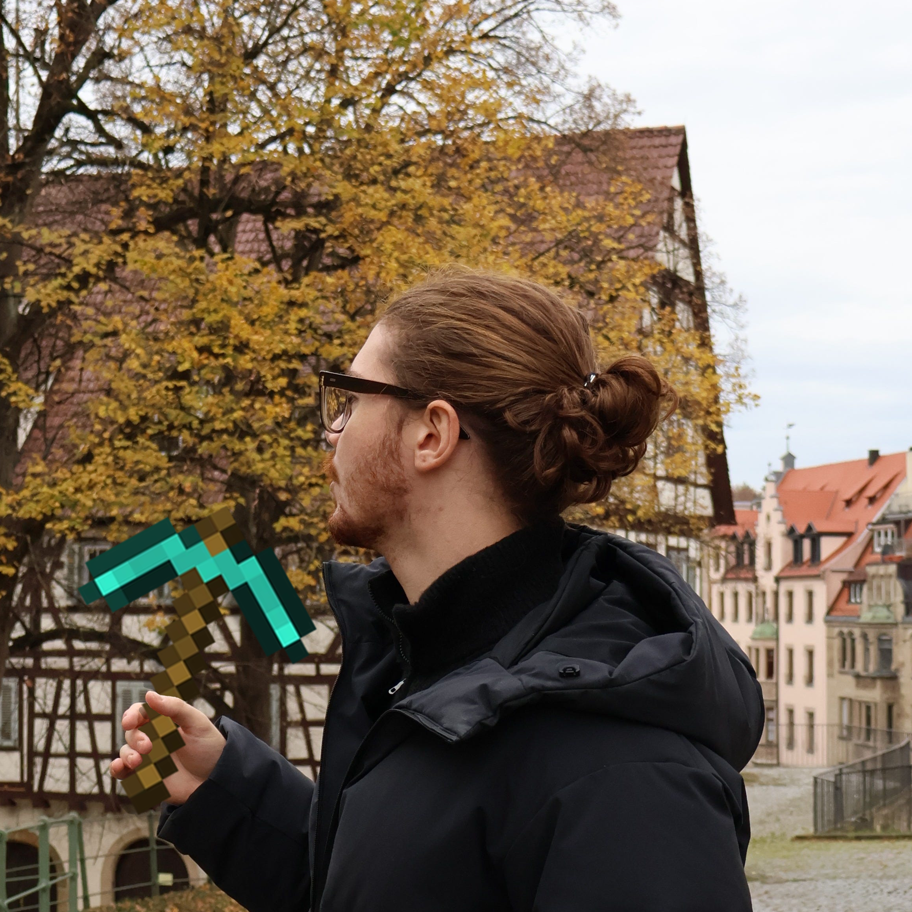

<aside class="profile-sidebar" aria-label="Profile">

aka *carruc*

<ul class="bio-links">

<li><a href="{{ social.url }}" aria-label="{{ social.label }}: {{ social.handle }}"><i class="{{ social.icon or 'fa-solid fa-link' }}" aria-hidden="true"></i>{{ social.handle or social.label }}</a></li>

</ul>

</aside>

I’m a master’s student in **Computer Science and Engineering at Politecnico di Milano** and a graduate researcher at **NECSTLab**.

## Current research

- **Language models and sensor data:** At NECSTLab, I’m studying how to encode sensor time series for language models that can help make sense of health data and translate this understanding in actionable insights. Under Professor Maurizio Magarini and PhD Arek Berc Gokdag.
- **[Italian Pretrain Dataset and SLM](https://github.com/SamueleTondelli/pavullmo):** we are building an all-italian, high-quality pretrain dataset and training a companion small language model in the 50-100M parameter range. Currently cooking the data pipeline.

## Projects


<ul>


<li><a href="{{ project.url }}">{{ project.data.title }}</a></li>


</ul>


[All projects →](/research/)

## Recent articles


<ul>


<li><a href="{{ entry.url }}">{{ entry.data.title }}</a></li>


</ul>


[All articles →](/articles/)

## Reading



I’m currently reading  and , {{ bookTitle(book) }}. Other books I've enjoyed as of late:

{{ bookList(reading.finished.concat(reading.literary), true) }}




Click here for the rest of my <a href="{{ entry.url }}">Library and Antilibrary →</a>




